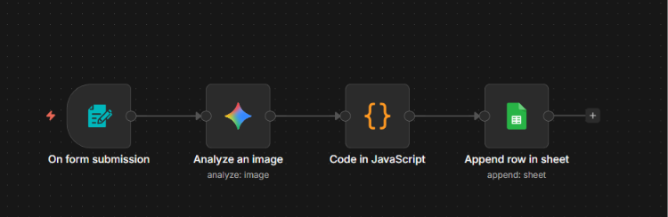

# 🧾 Akıllı Fatura ve Dekont Okuyucu (OCR + Multimodal AI)

Web formu üzerinden yüklenen banka dekontu, fatura ve alışveriş fişi görsellerini **Google Gemini Multimodal AI** ile analiz eden, yapılandırılmış **JSON** formatına dönüştüren ve **Google Sheets** muhasebe tablosuna otomatik olarak yeni satır halinde kaydeden uçtan uca bir n8n otomasyon projesidir.

---

## 🚀 Öne Çıkan Özellikler

* **Görsel Veri Çıkarımı (OCR + Vision AI):** Farklı banka ve işletmelere ait dağınık görsel belgeleri manuel veri girişine gerek kalmadan otomatik okur.
* **Yapılandırılmış Çıktı (Structured JSON):** Yapay zekadan serbest metin yerine kesin kurallara sahip 8 alanlı JSON nesnesi üretir.
* **Ayrıştırılmış IBAN Takibi:** İşlem güvenliği ve muhasebe mutabakatı için **Gönderici IBAN** ve **Alıcı IBAN** bilgilerini ayrı sütunlarda saklar.
* **Veri Temizleme ve Tip Güvenliği:** JavaScript katmanı ile markdown kalıntılarını temizler, tutar değerlerini sayısal (`Float`) formata çevirir ve eksik alanları standartlaştırır.

---

## ⚙️ İş Akışı Mimarisi (4 Adımlı Pipeline)

1. **Form Trigger (`On form submission`):** Kullanıcının `.jpg`, `.jpeg`, `.png` veya `.webp` formatında belge yükleyebileceği web arayüzünü sunar ve dosyayı ikili (`binary`) veri olarak akışa alır.
2. **Multimodal AI Analiz (`Google Gemini`):** Görseli inceler ve belge üzerindeki finansal bilgileri (`Tarih`, `Belge_Turu`, `Gonderici`, `Gonderici_IBAN`, `Alici`, `Alici_IBAN`, `Tutar`, `Para_Birimi`) JSON şemasında döndürür.
3. **Ayrıştırma ve Doğrulama (`Code in JavaScript`):** AI yanıtını `JSON.parse()` ile ayrıştırır, IBAN boşluklarını temizler, tutarı ondalıklı sayıya dönüştürür ve boş alanlara varsayılan değer atar.
4. **Bulut Muhasebe Kaydı (`Google Sheets`):** Doğrulanmış 8 sütunlu veri satırını hedef tabloya (`Append Row`) otomatik olarak işler.

---

## 🛠️ Kurulum ve Kullanım Adımları

1. **Google Sheets Tablosunu Hazırlayın:**
   Google Drive hesabınızda `Dekont_ve_Fatura_Kayitlari` adında yeni bir tablo oluşturun ve ilk satıra (`A1:H1`) şu 8 sütun başlığını birebir ekleyin:
   `Tarih` | `Belge_Turu` | `Gonderici` | `Gonderici_IBAN` | `Alici` | `Alici_IBAN` | `Tutar` | `Para_Birimi`

2. **Workflow Dosyasını İçe Aktarın:**
   Bu depodaki `Akilli_Dekont_ve_Fatura_Okuyucu_Public.json` dosyasını indirin ve kendi n8n arayüzünüzde **Import from File** seçeneğiyle yükleyin.

3. **Kimlik Bilgilerini (Credentials) Bağlayın:**
   * **Analyze an image (Google Gemini):** Kendi Google Gemini API anahtarınızı tanımlayın.
   * **Append row in sheet (Google Sheets):** Kendi Google hesabınızı bağlayıp oluşturduğunuz tabloyu (`Dekont_ve_Fatura_Kayitlari`) seçin.

4. **Çalıştırın:**
   İş akışını **Active** konumuna getirin ve Form Trigger üzerindeki üretim (Production) URL'si üzerinden belge yükleyerek kullanmaya başlayın.
